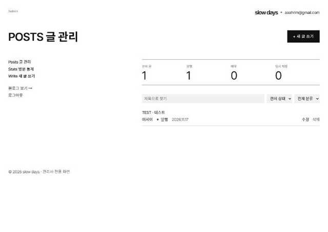
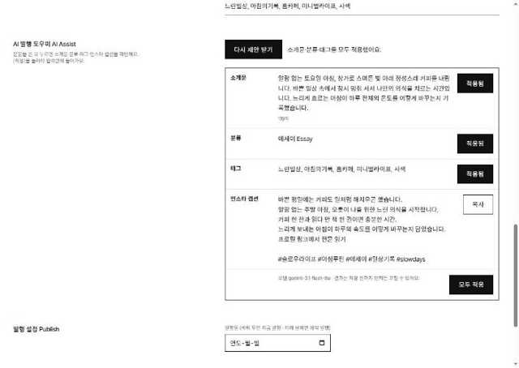
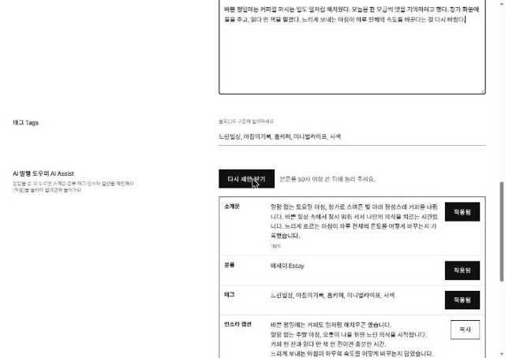
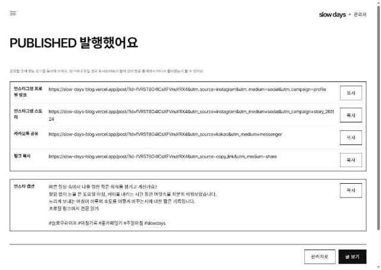
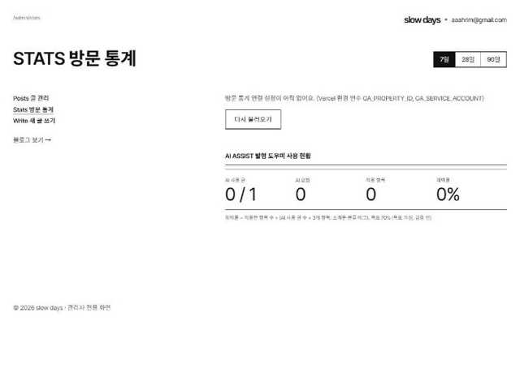
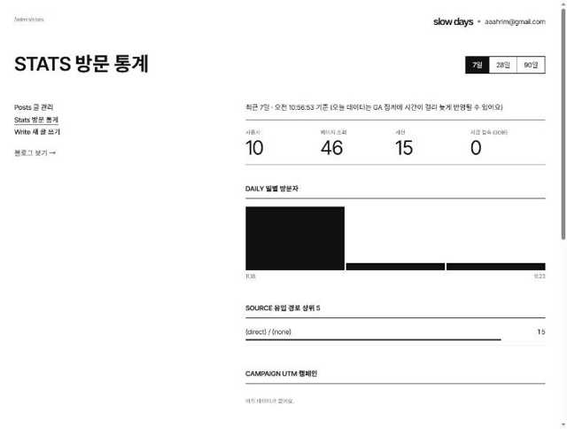

# 테스트 보고서 — slow days AI 발행 도우미

| 항목 | 내용 |
|---|---|
| 버전 · 일자 | v1.0 · 2026-11-24 |
| 대상 | https://slow-days-blog.vercel.app (Vercel 운영 배포) |
| 범위 | PRD 기능 F1~F5, 서버 함수 보안, 단위 테스트 |
| 결과 요약 | 단위 테스트 16/16 통과 · 유저플로우 테스트 12/12 통과 · 테스트 중 발견 결함 3건 수정 완료 |

## 1. 유저플로우 테스트 (운영 배포, 관리자 계정)

| 단계 · 기능 | 테스트 내용 | 기대 결과 | 결과 |
|---|---|---|---|
| U1 로그인 | /admin/ 관리자 로그인 | 글 관리 화면, 메뉴에 방문 통계 표시 | 통과 |
| U2 F1 AI 발행 준비 | 본문 약 300자 입력 후 [AI 발행 준비] | 10초 이내 소개문·분류·태그·캡션 수신 | 통과 (2.2초) |
| U3 F1 결과 적용 | [모두 적용] | 입력란 3개 채움, 버튼 "적용됨" | 통과 (소개문 119자, 분류 essay, 태그 5개) |
| U4 F4 인스타 캡션 | 캡션·해시태그 표시 | 3~5줄, 마지막 줄 '프로필 링크에서 전문 읽기', 해시태그 5개 | 통과 |
| U5 F5 입력 부족 | 본문 50자 미만 상태에서 요청 | 안내 문구 표시, 입력값 유지, 서버 호출 없음 | 통과 |
| U6 발행 | 테스트 글 발행 | 공유 링크 화면으로 전환 | 통과 |
| U7 F2 UTM 링크 | 공유 링크 4종 확인 | 인스타 profile·story_261124, kakao/messenger, copy_link/share | 통과 |
| U8 F2 복사 | [복사] 클릭 | 클립보드 복사, 버튼 "복사됨" | 통과 |
| U9 AI 사용 기록 | 발행 후 통계 화면 | AI 사용 글 1, 요청 1, 적용 3, 채택률 100% | 통과 |
| U10 F3 GA 미설정 | GA 환경 변수 없는 상태로 통계 화면 | 상단에 설정 안내, AI 현황은 정상 표시 | 통과 (결함 B-2 수정 후) |
| U11 F3 방문 통계 | GA 연결 후 통계 화면(7일) | 사용자·조회·세션·실시간, 일별·유입·인기 페이지 표시 | 통과 (사용자 10, 조회 46, 세션 15) |
| U12 정리 | 테스트 글 삭제 | 목록에서 제거 | 통과 |

## 2. 보안·오류 처리 테스트

| 항목 | 테스트 내용 | 결과 |
|---|---|---|
| S1 로그인 없음 | `POST /api/ai-assist`, `GET /api/stats` 토큰 없이 호출 | 401 "로그인이 필요해요" |
| S2 위조 토큰 | `Authorization: Bearer invalid` | 401 "로그인이 만료됐어요" |
| S3 잘못된 메서드 | `GET /api/ai-assist` | 405 |
| S4 비밀 값 노출 | 저장소·화면 코드에서 Gemini 키, 서비스 계정 키 검색 | 없음 (Vercel 환경 변수에만 존재) |

## 3. 단위 테스트 (`npm test`, Node 22 내장 테스트, 16/16 통과, 0.19초)

| 대상 · 테스트 | 확인 내용 |
|---|---|
| `assets/ai-core.js` · 7개 | 본문 기호 정리, AI 응답 JSON 추출(코드 블록 포함), 결과 검증(잘못된 분류 제거·태그 5개·해시태그 정리), 소개문 80~120자 판정, UTM 생성·필수값, 텍소노미 규칙 4종·한국 날짜 YYMMDD, 캡션 결합 |
| `api/_lib/gemini.js` · 4개 | 모델 우선순위, 키 없음 503, 모델 없음(404) 시 다음 모델 전환, 키 오류(403) 즉시 실패 |
| `api/ai-assist.js` · 1개 | 프롬프트에 제목·본문·분류 4종·JSON 항목 포함 |
| `api/_lib/ga.js`, `api/stats.js` · 4개 | 설정 없음·JSON 손상 503, 서비스 계정 JWT 서명 검증, GA 보고서 행 변환, 기간·일괄 요청 5개 |

## 4. 테스트 중 발견 결함

| ID · 결함 | 원인 | 조치 · 커밋 |
|---|---|---|
| B-1 테스트 실행 실패 | `node --test tests/`가 Node 22에서 폴더 미인식 | `node --test`로 변경 · `fix: 테스트 실행 명령 수정` |
| B-2 통계 오류 안내 위치 | GA 미설정 시 빈 칸만 보이고 안내는 하단 | 안내 상단 이동, 오류 시 통계 영역 숨김 · `fix: 통계 화면 오류 안내를 맨 위로 이동` |
| B-3 GA 권한 오류 원인 불명 | 403 문구만으로 속성 ID 오류 여부 판단 불가 → 실제 원인은 잘못된 속성 ID 입력 | 오류 문구에 사용 중 속성 ID·서비스 계정 표시 · `fix: GA 권한 오류 안내에 사용 중인 속성 ID·서비스 계정 표시` |

## 5. 화면 (유저플로우 순서)

| U1 관리자 글 관리 | U2~U4 AI 제안·적용 |
|---|---|
|  |  |
| **U5 입력 부족 안내** | **U6~U8 발행 후 UTM 링크** |
|  |  |
| **U9 AI 사용 기록** | **U10 GA 미설정 안내** |
|  |  |
| **U11 방문 통계** | |
|  | |

## 6. 미검증 · 한계

1. AI 응답 품질은 테스트 글 1건 기준. 글 유형별(책·공간) 품질은 운영 중 채택률로 확인 예정
2. KR1(발행 부가 작업 시간 50% 단축)은 측정 전 (목표 가설, 검증 전)
3. UTM 유입은 실제 인스타그램 게시 후 GA 반영까지 시간이 필요해 미검증

---
2.prov.ii · hi.prov.ii@gmail.com
